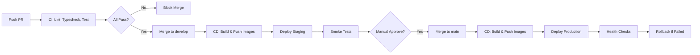

# YourTime - Plan de Infraestructura (Local + Cloud-Ready)

## Visión General

```
┌─────────────────────────────────────────────────────────────────────────┐
│                         LOCAL DEVELOPMENT                                │
│  ┌──────────────┐  ┌──────────────┐  ┌──────────────┐  ┌────────────┐  │
│  │   Backend    │  │    Web       │  │   Mobile     │  │  Infra     │  │
│  │  (Go:8080)   │  │  (Angular    │  │  (Expo:8081) │  │  (Docker)  │  │
│  │              │  │   :4200)     │  │              │  │            │  │
│  └──────┬───────┘  └──────┬───────┘  └──────┬───────┘  └─────┬──────┘  │
│         │                 │                 │                │         │
│         └─────────────────┼─────────────────┼────────────────┘         │
│                           ▼                 ▼                          │
│                    ┌─────────────────────────────────┐                │
│                    │     Docker Compose Stack        │                │
│                    │  ┌──────┐ ┌──────┐ ┌────────┐  │                │
│                    │  │Postgres│ │Redis │ │ MinIO  │  │                │
│                    │  │ :5432│ │:6379 │ │ :9000  │  │                │
│                    │  └──────┘ └──────┘ └────────┘  │                │
│                    │  ┌────────┐ ┌────────┐         │                │
│                    │  │Mailpit │ │ Caddy  │         │                │
│                    │  │ :1025  │ │ :80/443│         │                │
│                    │  └────────┘ └────────┘         │                │
│                    └─────────────────────────────────┘                │
└─────────────────────────────────────────────────────────────────────────┘

┌─────────────────────────────────────────────────────────────────────────┐
│                         PRODUCTION (Cloud-Ready)                        │
│                                                                         │
│  ┌─────────────┐    ┌─────────────┐    ┌─────────────┐                 │
│  │   Users     │    │   Users     │    │   Users     │                 │
│  │  (Mobile)   │    │   (Web)     │    │  (Admin)    │                 │
│  └──────┬──────┘    └──────┬──────┘    └──────┬──────┘                 │
│         │                  │                  │                         │
│         └──────────────────┼──────────────────┘                         │
│                            ▼                                            │
│                   ┌─────────────────┐                                   │
│                   │   CDN / WAF     │  (Cloudflare / CloudFront)       │
│                   │   + SSL Term    │                                   │
│                   └────────┬────────┘                                   │
│                            ▼                                            │
│                   ┌─────────────────┐                                   │
│                   │  Load Balancer  │  (ALB / Cloud Run / Nginx)       │
│                   └────────┬────────┘                                   │
│                            ▼                                            │
│         ┌──────────────────┼──────────────────┐                        │
│         ▼                  ▼                  ▼                        │
│  ┌─────────────┐   ┌─────────────┐   ┌─────────────┐                  │
│  │  Backend    │   │  Backend    │   │  Backend    │  (Auto-scaling)  │
│  │  Pod/Container          Pod/Container          Pod/Container        │
│  └──────┬──────┘   └──────┬──────┘   └──────┬──────┘                  │
│         │                 │                 │                          │
│         └─────────────────┼─────────────────┘                          │
│                           ▼                                            │
│         ┌─────────────────────────────────────────┐                   │
│         │         Managed Services                │                   │
│         │  ┌────────┐ ┌────────┐ ┌────────────┐  │                   │
│         │  │Cloud SQL│ │Redis   │ │Object Store│  │                   │
│         │  │Postgres │ │Cluster │ │(S3/GCS)    │  │                   │
│         │  └────────┘ └────────┘ └────────────┘  │                   │
│         └─────────────────────────────────────────┘                   │
└─────────────────────────────────────────────────────────────────────────┘
```

---

## Infraestructura Local (Docker Compose)

### `infra/docker/docker-compose.yml`

```yaml
version: '3.9'

services:
  # ===========================================
  # DATABASE
  # ===========================================
  postgres:
    image: postgres:16-alpine
    container_name: yourtime-postgres
    environment:
      POSTGRES_DB: yourtime
      POSTGRES_USER: yourtime
      POSTGRES_PASSWORD: ${DB_PASSWORD:-yourtime_dev}
    volumes:
      - postgres_data:/var/lib/postgresql/data
      - ./postgres/init:/docker-entrypoint-initdb.d:ro
      - ./postgres/postgresql.conf:/etc/postgresql/postgresql.conf:ro
    command: ["postgres", "-c", "config_file=/etc/postgresql/postgresql.conf"]
    ports:
      - "5432:5432"
    healthcheck:
      test: ["CMD-SHELL", "pg_isready -U yourtime -d yourtime"]
      interval: 5s
      timeout: 5s
      retries: 10
    networks:
      - yourtime-network

  # ===========================================
  # CACHE / SESSIONS / RATE LIMIT
  # ===========================================
  redis:
    image: redis:7-alpine
    container_name: yourtime-redis
    command: redis-server --appendonly yes --maxmemory 256mb --maxmemory-policy allkeys-lru
    volumes:
      - redis_data:/data
    ports:
      - "6379:6379"
    healthcheck:
      test: ["CMD", "redis-cli", "ping"]
      interval: 5s
      timeout: 3s
      retries: 10
    networks:
      - yourtime-network

  # ===========================================
  # OBJECT STORAGE (S3-compatible)
  # ===========================================
  minio:
    image: minio/minio:latest
    container_name: yourtime-minio
    command: server /data --console-address ":9001"
    environment:
      MINIO_ROOT_USER: ${MINIO_ROOT_USER:-yourtime}
      MINIO_ROOT_PASSWORD: ${MINIO_ROOT_PASSWORD:-yourtime_dev}
    volumes:
      - minio_data:/data
    ports:
      - "9000:9000"   # API
      - "9001:9001"   # Console
    healthcheck:
      test: ["CMD", "curl", "-f", "http://localhost:9000/minio/health/live"]
      interval: 10s
      timeout: 5s
      retries: 5
    networks:
      - yourtime-network

  # ===========================================
  # EMAIL TESTING
  # ===========================================
  mailpit:
    image: axllent/mailpit:latest
    container_name: yourtime-mailpit
    ports:
      - "1025:1025"  # SMTP
      - "8025:8025"  # Web UI
    networks:
      - yourtime-network

  # ===========================================
  # REVERSE PROXY / LOCAL HTTPS
  # ===========================================
  caddy:
    image: caddy:2-alpine
    container_name: yourtime-caddy
    ports:
      - "80:80"
      - "443:443"
      - "443:443/udp"
    volumes:
      - ./caddy/Caddyfile:/etc/caddy/Caddyfile:ro
      - caddy_data:/data
      - caddy_config:/config
    environment:
      - ACME_AGREE=true
      - ACME_EMAIL=${CADDY_EMAIL:-admin@yourtime.local}
    depends_on:
      - backend
      - web
    networks:
      - yourtime-network

  # ===========================================
  # BACKEND API
  # ===========================================
  backend:
    build:
      context: ../..
      dockerfile: infra/docker/Dockerfile.backend
    container_name: yourtime-backend
    environment:
      - APP_ENV=development
      - APP_PORT=8080
      - DATABASE_URL=postgres://yourtime:${DB_PASSWORD:-yourtime_dev}@postgres:5432/yourtime?sslmode=disable
      - REDIS_URL=redis://redis:6379
      - MINIO_ENDPOINT=minio:9000
      - MINIO_ACCESS_KEY=${MINIO_ROOT_USER:-yourtime}
      - MINIO_SECRET_KEY=${MINIO_ROOT_PASSWORD:-yourtime_dev}
      - MINIO_BUCKET=yourtime
      - MINIO_USE_SSL=false
      - JWT_SECRET=${JWT_SECRET:-dev-secret-change-me-32-chars-minimum}
      - JWT_ACCESS_TTL=15m
      - JWT_REFRESH_TTL=7d
      - SMTP_HOST=mailpit
      - SMTP_PORT=1025
      - EMAIL_FROM=noreply@yourtime.local
      - STRIPE_SECRET_KEY=${STRIPE_SECRET_KEY}
      - STRIPE_WEBHOOK_SECRET=${STRIPE_WEBHOOK_SECRET}
      - MERCADOPAGO_ACCESS_TOKEN=${MERCADOPAGO_ACCESS_TOKEN}
      - MERCADOPAGO_WEBHOOK_SECRET=${MERCADOPAGO_WEBHOOK_SECRET}
      - FEATURE_WEBSOCKETS=true
    depends_on:
      postgres:
        condition: service_healthy
      redis:
        condition: service_healthy
      minio:
        condition: service_healthy
    ports:
      - "8080:8080"
    networks:
      - yourtime-network
    # Hot reload en desarrollo
    volumes:
      - ../../apps/backend:/app
      - /app/bin
    command: air -c .air.toml

  # ===========================================
  # FRONTEND WEB (Angular Dev Server)
  # ===========================================
  web:
    build:
      context: ../..
      dockerfile: infra/docker/Dockerfile.web
    container_name: yourtime-web
    environment:
      - NODE_ENV=development
    ports:
      - "4200:4200"
    volumes:
      - ../../apps/web:/app
      - /app/node_modules
      - /app/dist
    command: npm run start -- --host 0.0.0.0 --poll 1000
    networks:
      - yourtime-network
    depends_on:
      - backend

volumes:
  postgres_data:
  redis_data:
  minio_data:
  caddy_data:
  caddy_config:

networks:
  yourtime-network:
    driver: bridge
```

### `infra/docker/Caddyfile` (Local HTTPS)

```caddyfile
{
    admin off
    local_certs
    email {$ACME_EMAIL}
}

# Backend API
api.yourtime.local {
    reverse_proxy backend:8080
    
    # WebSocket support
    @websocket {
        header Connection *Upgrade*
        header Upgrade websocket
    }
    reverse_proxy @websocket backend:8080 {
        transport http {
            # WebSocket support
        }
    }
}

# Frontend Web
yourtime.local {
    reverse_proxy web:4200
    
    # Spa fallback
    try_files {path} /index.html
    
    # Cache static assets
    @static {
        path /assets/*
        path *.js *.css *.woff2 *.png *.jpg *.svg *.ico
    }
    header @static Cache-Control "public, max-age=31536000, immutable"
}

# MinIO Console
minio.yourtime.local {
    reverse_proxy minio:9001
}

# Mailpit
mail.yourtime.local {
    reverse_proxy mailpit:8025
}
```

### `infra/docker/.env.example`

```bash
# ===========================================
# DATABASE
# ===========================================
DB_PASSWORD=yourtime_dev

# ===========================================
# MINIO (S3-compatible)
# ===========================================
MINIO_ROOT_USER=yourtime
MINIO_ROOT_PASSWORD=yourtime_dev

# ===========================================
# JWT
# ===========================================
JWT_SECRET=your-super-secret-jwt-key-change-in-production-min-32-chars-long

# ===========================================
# EMAIL (Mailpit local - no config needed)
# ===========================================

# ===========================================
# PAYMENTS - Stripe (get from dashboard)
# ===========================================
STRIPE_SECRET_KEY=sk_test_...
STRIPE_PUBLISHABLE_KEY=pk_test_...
STRIPE_WEBHOOK_SECRET=whsec_...

# ===========================================
# PAYMENTS - MercadoPago (get from dashboard)
# ===========================================
MERCADOPAGO_ACCESS_TOKEN=TEST-...
MERCADOPAGO_PUBLIC_KEY=TEST-...
MERCADOPAGO_WEBHOOK_SECRET=...

# ===========================================
# CADDY (Local HTTPS)
# ===========================================
CADDY_EMAIL=admin@yourtime.local

# ===========================================
# EXPO (Mobile)
# ===========================================
EXPO_PUBLIC_API_URL=https://api.yourtime.local/api/v1
```

---

## Dockerfiles

### `infra/docker/Dockerfile.backend`

```dockerfile
# ===========================================
# BUILD STAGE
# ===========================================
FROM golang:1.23-alpine AS builder

# Install build dependencies
RUN apk add --no-cache git make gcc musl-dev

WORKDIR /app

# Cache dependencies
COPY apps/backend/go.mod apps/backend/go.sum ./
RUN go mod download

# Copy source
COPY apps/backend/ ./

# Build
RUN CGO_ENABLED=0 go build -ldflags="-s -w" -o /server ./cmd/server

# ===========================================
# RUN STAGE
# ===========================================
FROM alpine:3.20

# Install runtime dependencies
RUN apk add --no-cache ca-certificates tzdata curl

# Create non-root user
RUN adduser -D -u 1000 appuser

WORKDIR /app

# Copy binary
COPY --from=builder /server /app/server

# Copy migrations
COPY apps/backend/internal/infrastructure/persistence/postgres/migrations ./migrations

# Change ownership
RUN chown -R appuser:appuser /app

USER appuser

EXPOSE 8080

HEALTHCHECK --interval=30s --timeout=5s --start-period=10s --retries=3 \
    CMD curl -f http://localhost:8080/health || exit 1

ENTRYPOINT ["/app/server"]
```

### `infra/docker/Dockerfile.web`

```dockerfile
# ===========================================
# BUILD STAGE
# ===========================================
FROM node:20-alpine AS builder

WORKDIR /app

# Enable pnpm
RUN corepack enable pnpm

# Copy package files
COPY package.json pnpm-lock.yaml pnpm-workspace.yaml ./
COPY apps/web/package.json apps/web/
COPY packages/*/package.json packages/*/

# Install dependencies
RUN pnpm install --frozen-lockfile

# Copy source
COPY apps/web/ apps/web/
COPY packages/ packages/

# Build
WORKDIR /app/apps/web
RUN pnpm run build

# ===========================================
# RUN STAGE (Nginx para producción)
# ===========================================
FROM nginx:alpine AS runner

# Copy built assets
COPY --from=builder /app/apps/web/dist/yourtime/browser /usr/share/nginx/html

# Copy nginx config
COPY infra/docker/nginx.conf /etc/nginx/conf.d/default.conf

EXPOSE 80

CMD ["nginx", "-g", "daemon off;"]
```

### `infra/docker/nginx.conf` (para producción web)

```nginx
server {
    listen 80;
    server_name localhost;
    root /usr/share/nginx/html;
    index index.html;

    # Gzip
    gzip on;
    gzip_types text/plain text/css application/json application/javascript text/xml application/xml application/xml+rss text/javascript;

    # Security headers
    add_header X-Frame-Options "SAMEORIGIN";
    add_header X-Content-Type-Options "nosniff";
    add_header X-XSS-Protection "1; mode=block";
    add_header Referrer-Policy "strict-origin-when-cross-origin";

    # Cache static assets
    location ~* \.(js|css|png|jpg|jpeg|gif|ico|svg|woff|woff2)$ {
        expires 1y;
        add_header Cache-Control "public, immutable";
        try_files $uri =404;
    }

    # SPA fallback
    location / {
        try_files $uri $uri/ /index.html;
    }

    # API proxy (si no hay CDN)
    location /api/ {
        proxy_pass http://backend:8080;
        proxy_http_version 1.1;
        proxy_set_header Upgrade $http_upgrade;
        proxy_set_header Connection 'upgrade';
        proxy_set_header Host $host;
        proxy_cache_bypass $http_upgrade;
        proxy_set_header X-Real-IP $remote_addr;
        proxy_set_header X-Forwarded-For $proxy_add_x_forwarded_for;
        proxy_set_header X-Forwarded-Proto $scheme;
    }
}
```

---

## Cloud-Ready: Opciones por Proveedor

### Opción 1: Google Cloud Platform (Recomendado para Go)

| Servicio | GCP Equivalente | Configuración |
|----------|-----------------|---------------|
| Compute | **Cloud Run** (serverless containers) | Auto-scale 0-N, pay per request |
| Database | **Cloud SQL PostgreSQL** | HA, backups automáticos, read replicas |
| Cache | **Memorystore Redis** | HA, auto-failover |
| Storage | **Cloud Storage** | Multi-regional, lifecycle policies |
| Secrets | **Secret Manager** | Versionado, audit logs |
| Build | **Cloud Build** / **Artifact Registry** | Docker images, vulnerability scanning |
| CDN | **Cloud CDN** + **Cloud Load Balancing** | Global anycast IP, SSL managed |
| DNS | **Cloud DNS** | Low latency, DNSSEC |
| Monitoring | **Cloud Monitoring** + **Cloud Logging** | Dashboards, alerting, tracing |
| CI/CD | **Cloud Deploy** | Progressive delivery, canary |

**Arquitectura GCP:**
```yaml
# cloudrun.yaml (Backend)
apiVersion: serving.knative.dev/v1
kind: Service
metadata:
  name: yourtime-backend
  annotations:
    run.googleapis.com/ingress: all
    run.googleapis.com/execution-environment: gen2
spec:
  template:
    metadata:
      annotations:
        autoscaling.knative.dev/minScale: "1"
        autoscaling.knative.dev/maxScale: "100"
        run.googleapis.com/cpu-throttling: "false"
        run.googleapis.com/memory: "512Mi"
        run.googleapis.com/cpu: "1"
    spec:
      containers:
        - image: us-central1-docker.pkg.dev/PROJECT/yourtime/backend:latest
          ports:
            - containerPort: 8080
          env:
            - name: DATABASE_URL
              valueFrom:
                secretKeyRef:
                  name: database-url
                  key: url
            - name: JWT_SECRET
              valueFrom:
                secretKeyRef:
                  name: jwt-secret
                  key: secret
          resources:
            limits:
              memory: 512Mi
              cpu: "1"
```

### Opción 2: AWS

| Servicio | AWS Equivalente |
|----------|-----------------|
| Compute | **ECS Fargate** / **App Runner** |
| Database | **RDS PostgreSQL** (Multi-AZ) |
| Cache | **ElastiCache Redis** |
| Storage | **S3** |
| Secrets | **Secrets Manager** / **Parameter Store** |
| CDN | **CloudFront** |
| LB | **Application Load Balancer** |
| DNS | **Route 53** |
| Monitoring | **CloudWatch** + **X-Ray** |
| CI/CD | **CodePipeline** / **GitHub Actions** |

### Opción 3: Fly.io (Más Simple, Buen DX)

```toml
# fly.toml (Backend)
app = "yourtime-backend"
primary_region = "ord"

[build]
  dockerfile = "infra/docker/Dockerfile.backend"

[env]
  PORT = "8080"
  APP_ENV = "production"

[http_service]
  internal_port = 8080
  force_https = true
  auto_stop_machines = true
  auto_start_machines = true
  min_machines_running = 1
  processes = ["app"]

[[vm]]
  memory = "512mb"
  cpu_kind = "shared"
  cpus = 1

# PostgreSQL: fly postgres create --name yourtime-db
# Redis: fly redis create --name yourtime-redis
```

### Opción 4: Railway / Render (Más Simple para MVP)

- Conectar repo GitHub
- Auto-detecta Dockerfile
- PostgreSQL/Redis incluidos
- Deploy automático en push a main
- Buen para validar MVP rápido

---

## Kubernetes (Para Futuro - Helm Chart Structure)

```
infra/kubernetes/
├── yourtime/
│   ├── Chart.yaml
│   ├── values.yaml
│   ├── values-dev.yaml
│   ├── values-staging.yaml
│   ├── values-prod.yaml
│   ├── templates/
│   │   ├── backend-deployment.yaml
│   │   ├── backend-service.yaml
│   │   ├── backend-hpa.yaml
│   │   ├── web-deployment.yaml
│   │   ├── web-service.yaml
│   │   ├── ingress.yaml
│   │   ├── configmap.yaml
│   │   ├── secret.yaml
│   │   ├── servicemonitor.yaml
│   │   └── poddisruptionbudget.yaml
│   └── charts/
│       ├── postgresql/ (dependency)
│       ├── redis/ (dependency)
│       └── minio/ (dependency)
```

---

## CI/CD Pipeline (GitHub Actions)

### Flujo Completo



### Secrets Requeridos (GitHub Settings > Secrets)

```
# Docker / Registry
DOCKERHUB_USERNAME / GHCR_TOKEN
DOCKERHUB_TOKEN

# Cloud Provider (ej. GCP)
GCP_PROJECT_ID
GCP_SA_KEY (base64 encoded service account)
GCP_REGION

# Database (para migraciones en CD)
DATABASE_URL_PROD
DATABASE_URL_STAGING

# App Secrets
JWT_SECRET_PROD
JWT_SECRET_STAGING

# Payments
STRIPE_SECRET_KEY_PROD
STRIPE_WEBHOOK_SECRET_PROD
MERCADOPAGO_ACCESS_TOKEN_PROD
MERCADOPAGO_WEBHOOK_SECRET_PROD

# Monitoring
SENTRY_DSN
DATADOG_API_KEY
```

---

## Observabilidad (Monitoring, Logging, Tracing)

### Métricas Clave (Prometheus + Grafana)

```yaml
# Métricas de aplicación (backend)
- http_requests_total{method, path, status}
- http_request_duration_seconds{method, path}
- active_users_total
- tasks_created_total
- tasks_completed_total
- tokens_purchased_total
- tokens_withdrawn_total
- withdrawal_amount_usd_total
- platform_revenue_usd_total
- db_query_duration_seconds
- redis_operations_total
- websocket_connections_active

# Métricas de negocio
- mau (monthly active users)
- task_conversion_rate (views -> applications -> completed)
- avg_task_value_tokens
- user_retention_d1, d7, d30
- worker_earnings_distribution
```

### Logs Estructurados (Zerolog → JSON → Loki/Elastic)

```go
// Estándar de log
log.Info().
    Str("trace_id", traceID).
    Str("span_id", spanID).
    Str("user_id", userID).
    Str("action", "task.completed").
    Int64("task_id", taskID).
    Int64("tokens_paid", tokensPaid).
    Dur("duration_ms", elapsed).
    Msg("Task completed successfully")
```

### Distributed Tracing (OpenTelemetry)

```go
// middleware/tracing.go
func TracingMiddleware(next http.Handler) http.Handler {
    return http.HandlerFunc(func(w http.ResponseWriter, r *http.Request) {
        ctx, span := otel.Tracer("yourtime").Start(r.Context(), 
            fmt.Sprintf("%s %s", r.Method, r.URL.Path),
            otelattribute.String("http.method", r.Method),
            otelattribute.String("http.url", r.URL.String()),
        )
        defer span.End()
        
        // Propagar trace context en headers salientes
        next.ServeHTTP(w, r.WithContext(ctx))
    })
}
```

### Alertas Críticas (PagerDuty / Opsgenie / Slack)

| Alerta | Condición | Severidad |
|--------|-----------|-----------|
| API Down | Health check failing > 1min | P1 (Critical) |
| High Error Rate | 5xx > 5% por 5min | P1 |
| High Latency | p99 > 2s por 5min | P2 |
| DB Connections | > 80% pool used | P2 |
| Disk Space | > 85% | P2 |
| Failed Withdrawals | > 3 en 1 hora | P2 |
| Payment Webhook Failures | > 5 en 10min | P1 |
| Queue Backlog | > 1000 jobs pending | P3 |

---

## Backup & Disaster Recovery

### Base de Datos
- **Automated**: Daily snapshots (retención 30 días)
- **Point-in-time recovery**: Habilitado (PITR)
- **Cross-region replica**: Para DR (RPO < 5min, RTO < 30min)
- **Test restore**: Mensual (automatizado)

### Object Storage (MinIO/S3)
- **Versioning**: Habilitado
- **Lifecycle**: Move to cold storage after 90 días
- **Cross-region replication**: Para assets críticos

### Secrets
- **Rotation**: JWT secret cada 90 días (automatizado)
- **Backup**: En Vault/Secret Manager con versionado

---

## Checklist de Producción (Go-Live)

### Seguridad
- [ ] TLS 1.2+ en todos los endpoints
- [ ] HSTS, CSP, Security headers configurados
- [ ] Rate limiting en auth, payments, public endpoints
- [ ] WAF rules (SQLi, XSS, bot protection)
- [ ] Secrets rotados y en Secret Manager
- [ ] Database encryption at rest + in transit
- [ ] VPC/Private subnets para DB, Redis
- [ ] Security groups restrictivos (least privilege)

### Confiabilidad
- [ ] Health checks (liveness + readiness)
- [ ] Auto-scaling configurado (CPU/memory/custom metrics)
- [ ] Circuit breakers en llamadas externas (Stripe, MP, Email)
- [ ] Retry con exponential backoff + jitter
- [ ] Dead letter queues para async jobs
- [ ] Graceful shutdown (SIGTERM handling)

### Operaciones
- [ ] Runbooks documentados para incidentes comunes
- [ ] On-call rotation configurado
- [ ] Dashboards de negocio + técnicos
- [ ] Alertas con runbook links
- [ ] Log retention policy (30d hot, 1yr cold)
- [ ] Cost monitoring + budgets alerts

### Compliance
- [ ] PCI DSS SAQ-A (si procesa pagos directo) o delegado a Stripe/MP
- [ ] GDPR/LGPD: Data export, deletion, consent
- [ ] Términos y condiciones, Privacy policy
- [ ] KYC/AML para retiros > threshold