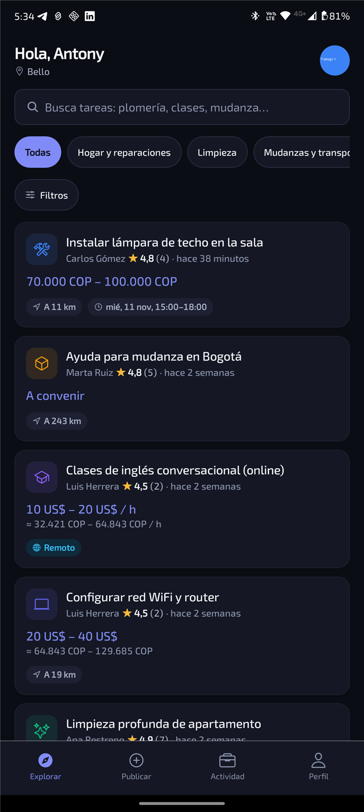
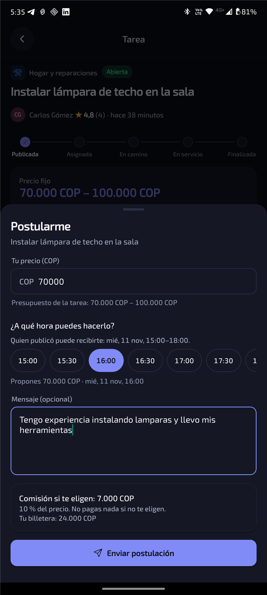
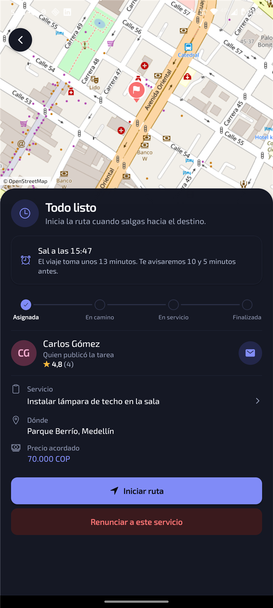

# YourTime

**Pide ayuda cerca de ti, o gana ayudando.**

YourTime conecta a quien necesita una tarea (arreglos, limpieza, clases, mudanzas, mandados) con
personas cercanas que pueden hacerla. Publicas lo que necesitas con tu rango de precio y el horario
en que puedes recibir el servicio; quienes se postulan proponen su precio y su hora, y tú eliges.

  
  
  

## Cómo funciona

1. **Publica.** Di qué necesitas, cuánto estás dispuesto a pagar y en qué franja horaria puedes
   recibir el servicio (por ejemplo, "jueves de 14:00 a 18:00"). Puede ser presencial o a distancia.
2. **Elige.** Cada persona que se postula propone un precio y una hora dentro de tu franja. Ves su
   calificación, su puntualidad y su perfil con fotos de su trabajo antes de decidir.
3. **Sigue el servicio.** Mira en el mapa cuándo llega y cuánto lleva trabajando.
4. **Califica.** Los dos se califican; las reseñas ayudan a elegir mejor la próxima vez.

Si te eligen a ti, la app calcula cuánto tardas en llegar y **te avisa 10 y 5 minutos antes de la
hora en que debes salir**.

## Descargar

La app está en pruebas y por ahora es solo para **Android** (7.0 o superior).

1. Abre la última versión en [Releases](../../releases/latest) y descarga `YourTime.apk`.
2. Ábrelo en el teléfono. Si Android lo pide, permite instalar apps de esta fuente.
3. Crea tu cuenta con tu correo.

Las versiones nuevas se instalan encima de la anterior sin perder tu cuenta.

## Guía

- [Publicar una tarea](guia/publicar.md)
- [Postularte a una tarea](guia/postularse.md)
- [El servicio en vivo y los avisos para salir](guia/servicio.md)
- [Billetera y comisión](guia/billetera.md)
- [Tu perfil: foto, "Sobre mí" y reseñas](guia/perfil.md)

## Preguntas frecuentes

**¿Cuánto cuesta?** Postularse es gratis. Solo si te eligen se descuenta una comisión del precio
acordado de tu billetera, y si el servicio no llega a empezar te la devuelven.

**¿Quién ve mi dirección?** Quienes se postulan ven solo una zona aproximada. La dirección exacta la
ve únicamente la persona que elijas.

**¿Mis fotos muestran dónde las tomé?** No. Al subirlas se les quitan los datos de ubicación que
guarda el teléfono.

**¿En qué idiomas está?** Español, inglés, portugués y francés.

---

El código de YourTime es privado. Este repositorio solo muestra la app y la distribuye.
