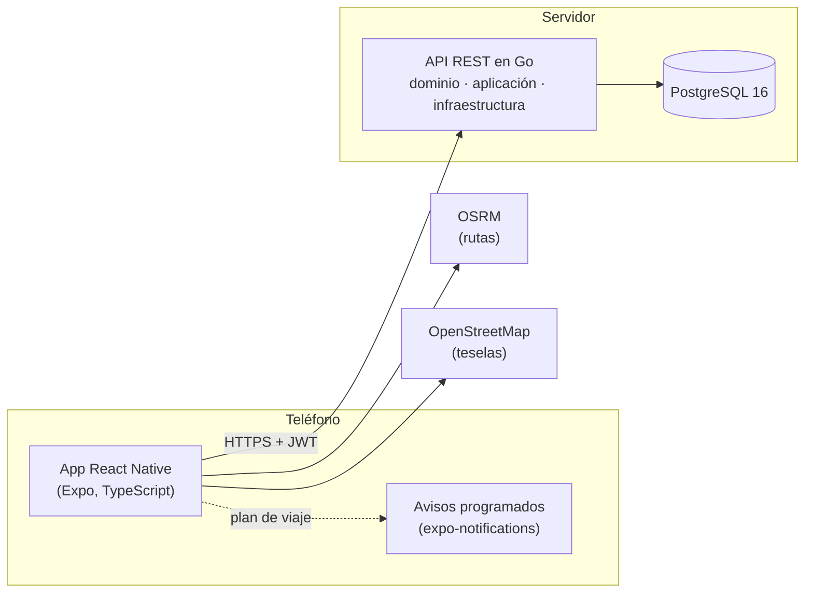

# Cómo está construido YourTime

Resumen técnico del proyecto. El código fuente es privado; está disponible para revisión técnica a
solicitud.

## Stack

| Capa | Tecnologías |
| --- | --- |
| **App móvil** | React Native 0.76 (nueva arquitectura) · Expo SDK 52 · Expo Router · TypeScript · TanStack Query · Zustand · Reanimated · react-native-svg |
| **Funciones nativas** | expo-location (GPS) · expo-notifications (avisos programados en el teléfono) · expo-image-picker / image-manipulator (fotos) · SecureStore (sesión) |
| **API** | Go 1.23 · chi (router) · pgx (PostgreSQL) · goose (migraciones embebidas) · JWT con tokens de renovación · validator · zerolog · golang.org/x/image |
| **Datos** | PostgreSQL 16 · consultas SQL a mano (sin ORM) · haversine en SQL · índices parciales únicos |
| **Mapas y rutas** | Mapa propio dibujado con teselas de OpenStreetMap y SVG · rutas por carretera con OSRM |
| **Monorepo** | pnpm workspaces · paquetes compartidos de tipos y utilidades (dinero, distancias, fechas, i18n) usados por la app |
| **Calidad** | Pruebas unitarias y de integración en Go contra PostgreSQL real · Vitest · GitHub Actions · Prettier · gofmt/go vet · Husky + commitlint (Conventional Commits) |
| **Infraestructura** | Docker y Docker Compose · compilación del APK en un contenedor (JDK 17, Android SDK 35) · Tailscale Funnel · plantilla de despliegue para Render + Neon |
| **Idiomas** | Español, inglés, portugués y francés, con extractor de textos y prueba que falla si falta una traducción |

## Arquitectura

La API sigue una **arquitectura por capas** (dominio, casos de uso e infraestructura):

- **Dominio:** reglas del negocio sin dependencias externas, como la máquina de estados de una tarea, la validación de franjas horarias o las reglas de la página de perfil.
- **Aplicación:** casos de uso.
- **Infraestructura:** HTTP, PostgreSQL y procesamiento de imágenes.

Las reglas se prueban sin base de datos y las consultas, contra una real.

## Decisiones técnicas que vale la pena mencionar

- **Concurrencia resuelta en la base de datos.** "Un servicio activo a la vez por persona" y "una sola
  persona elegida por tarea" se garantizan con índices únicos parciales y bloqueos de fila, no solo con
  lógica en la app. Dos elecciones simultáneas no pueden ganar las dos.
- **Billetera con libro de movimientos.** Cada recarga, comisión y devolución es un asiento. La
  comisión se cobra en la misma transacción que la elección y se devuelve si el servicio no empieza.
- **Puntualidad justa, calculada al leer.** Se calcula en SQL a partir de los servicios terminados, así
  nunca se desincroniza. No penaliza el tráfico si la persona salió a tiempo según el viaje planeado,
  ni cuenta servicios en los que no había tiempo para llegar.
- **Avisos sin servidor de push.** El teléfono calcula la ruta y programa los avisos "sal ya" a 10 y
  5 minutos. Llegan con la app cerrada y funcionan igual en Android e iOS.
- **Privacidad por diseño.**
  - Quien no participa en una tarea ve la ubicación redondeada a ~1 km, y las distancias se calculan
    desde ese punto para que no se pueda triangular.
  - Los datos de contacto solo se comparten entre las dos partes, y se ocultan si el servicio se cancela.
  - Las fotos se recodifican en el servidor, lo que borra su ubicación GPS.
- **Imágenes portables.** Se guardan en PostgreSQL detrás de una interfaz, así viajan con los
  respaldos y el paso a almacenamiento de objetos (S3/R2) no toca el resto del código.
- **Hora negociada.** Quien publica da una franja horaria y cada postulante propone una hora dentro
  de ella. La hora acordada es la base de los avisos y de la puntualidad.

## Cómo se prueba

- **Dominio:** pruebas unitarias de reglas y casos límite.
- **De extremo a extremo:** contra la API real y PostgreSQL. Cubren registro, publicar, postular, elegir, servicio en vivo, reseñas, billetera, franjas horarias, puntualidad y fotos.
- **Paquetes compartidos:** pruebas de dinero, conversión de monedas, distancias, fechas y traducciones.
- **CI:** en cada cambio corre formato, análisis estático, pruebas, comprobación de tipos, empaquetado de la app e imagen Docker.
- **Pruebas manuales guiadas en un teléfono real** antes de cada versión.

[← Volver](README.md)
