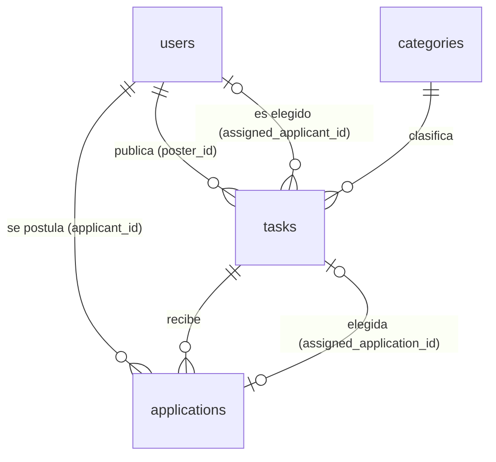

# Modelo de datos

PostgreSQL 16. **La fuente de verdad es la migración**
[`apps/backend/internal/infrastructure/persistence/postgres/migrations/00001_init.sql`](../apps/backend/internal/infrastructure/persistence/postgres/migrations/00001_init.sql).
Este documento explica las decisiones; no repite el SQL.



## Tablas

| Tabla          | Propósito                                                                                                   |
| -------------- | ----------------------------------------------------------------------------------------------------------- |
| `users`        | Cuenta, perfil y preferencias (moneda, ubicación, radio)                                                    |
| `categories`   | Catálogo de categorías, sembrado en la propia migración                                                     |
| `tasks`        | Solicitudes publicadas, con su presupuesto, ubicación y estado                                              |
| `applications` | Ofertas de las personas que se postulan a una tarea                                                         |
| `reviews`      | Calificación de 1 a 5 y comentario entre las dos partes de una tarea finalizada, con una respuesta opcional |

## Decisiones

- **Dinero en enteros.** `budget_min_minor`, `budget_max_minor` y `price_minor` son `BIGINT` en
  unidades menores. La moneda de cada tarea se guarda en `tasks.currency` y las postulaciones usan la
  de su tarea. No hay tipos decimales ni tasas de cambio.
- **Moneda de la cuenta** en `users.currency` (`CHAR(3)`, ISO 4217). Es solo la preferencia por
  defecto; cada tarea fija la suya al publicarse.
- **Ubicación como par de `DOUBLE PRECISION`.** `users.search_radius_km` nulo significa sin límite.
  Los `CHECK` garantizan que latitud y longitud existan juntas y que una tarea presencial tenga
  ubicación.
- **Distancia con haversine en SQL**, sobre un punto redondeado a 2 decimales para quien no es
  parte de la tarea (ver privacidad en [`PRODUCT.md`](PRODUCT.md)). Un índice parcial sobre
  `(location_lat, location_lng)` de tareas abiertas ayuda a las consultas con filtros; el cálculo
  sigue siendo un recorrido sobre las abiertas. Cuando la tabla crezca, el siguiente paso es PostGIS
  con índice GiST (ver `ROADMAP.md`).
- **Una sola persona elegida por tarea**, garantizado por el índice único parcial
  `applications_one_accepted_idx` (`WHERE status = 'accepted'`), además de la lógica de la
  aplicación.
- **Una postulación por persona y tarea**, por la restricción única `(task_id, applicant_id)`.
  Quien retiró puede volver a postularse: la fila se reactiva en vez de duplicarse.
- **Un servicio a la vez, garantizado por la base de datos.** Los índices únicos parciales
  `tasks_one_active_per_poster` (`poster_id`) y `tasks_one_active_per_worker`
  (`assigned_applicant_id`), ambos `WHERE status IN ('assigned','en_route','in_progress')`, impiden
  tener dos servicios activos como cliente o como trabajador. Al elegir, la violación del índice se
  traduce a `client_busy` o `worker_busy`. Así la regla aguanta que dos personas contraten al mismo
  trabajador en el mismo instante. La migración falla si ya existen datos que la incumplen.
- **Posición en vivo en la propia tarea.** `worker_lat`, `worker_lng` y `worker_location_at` guardan
  solo el último punto, sin historial: es lo que muestra el mapa y se pone a `NULL` cuando el servicio
  termina, se cancela o se renuncia. Un `CHECK` exige que latitud y longitud existan juntas.
  `en_route_at` y `started_at` registran cuándo salió y cuándo empezó (de ahí el cronómetro).
  `route_eta_seconds` guarda el trayecto estimado al salir (migración 00006, con un `CHECK` de 0 a
  86 400); se borra al renunciar.
- **Confiabilidad calculada, no guardada.** El tiempo de respuesta y la puntualidad se calculan al
  leer con una subconsulta lateral sobre las tareas finalizadas de la persona
  (`tasks_worker_completed_idx`). Sin contadores aparte no hay nada que se desincronice, a costa de
  una agregación por persona; si pesara, el siguiente paso sería guardar totales como se hizo con la
  calificación.
- **Idioma de la cuenta.** `users.language` (migración 00007) guarda el idioma elegido, o `NULL` si la
  persona sigue al dispositivo. Un `CHECK` limita los valores a los que traducen las apps.
- **Estados como `VARCHAR` con `CHECK`** (no `ENUM` de Postgres), para poder añadir estados con una
  migración simple.
- **Calificación como totales en `users`.** `rating_sum` y `rating_count` se actualizan en la
  misma transacción que inserta la reseña, así que mostrar `★ 4,8 (12)` junto a cada nombre es una
  lectura constante, sin agregar sobre `reviews` en cada listado. Se guardan suma y cantidad (no el
  promedio) para que sea siempre exacto.
- **Una reseña por persona y tarea**, por `reviews_one_per_reviewer` `(task_id, reviewer_id)`.
  `CHECK` impide calificarse a sí mismo, fuerza 1 a 5 y exige que `reply` y `replied_at` existan
  juntos. La respuesta es una sola columna: solo se acepta una.
- **Contador de postulaciones calculado**, no almacenado: se cuenta en la consulta para que nunca se
  desincronice.
- **El balance no tiene tabla propia**: se calcula sobre las tareas finalizadas y el precio de la
  postulación elegida (`tasks.assigned_application_id`). Dos índices parciales sobre
  `status = 'completed'`, `tasks_worker_completed_idx` y `tasks_poster_completed_idx`
  (persona, `completed_at`), hacen barata la suma por periodo. Se agrupa por la moneda de la tarea.
- **Tipos de cambio con historial** en `exchange_rates` `(rate_date, currency)` → `per_usd` (unidades
  de la moneda por 1 USD). Una fila por moneda y día, así cualquier par se convierte pasando por el
  dólar y un servicio antiguo conserva el cambio de su día. El día más cercano disponible se usa
  cuando falta uno. Nunca se escribe sobre una tarea o un precio: la conversión es solo de lectura.
- **Correo único sin distinguir mayúsculas**, con el índice `lower(email)`.
- **Búsqueda de texto** con `ILIKE` y un índice `pg_trgm` sobre el título.

## Concurrencia

Las operaciones que cambian el estado de una tarea toman un **bloqueo de fila**
(`SELECT … FOR UPDATE`) sobre la tarea y aplican las reglas de dominio dentro de la transacción.
Postularse toma `FOR SHARE`, de modo que no se puede adjuntar una postulación a una tarea que
justo se cierra. El orden de bloqueo es siempre tarea y luego postulaciones, para evitar
interbloqueos. Hay una prueba de extremo a extremo con ocho elegidores concurrentes.

## Migraciones

Con [goose](https://github.com/pressly/goose). Los `.sql` están **embebidos en el binario**; en
desarrollo el servidor las aplica al arrancar (`DB_AUTO_MIGRATE`). Manualmente:

```bash
make migrate                                   # aplica
cd apps/backend && go run ./scripts/migrate -direction down   # deshace un paso
```
