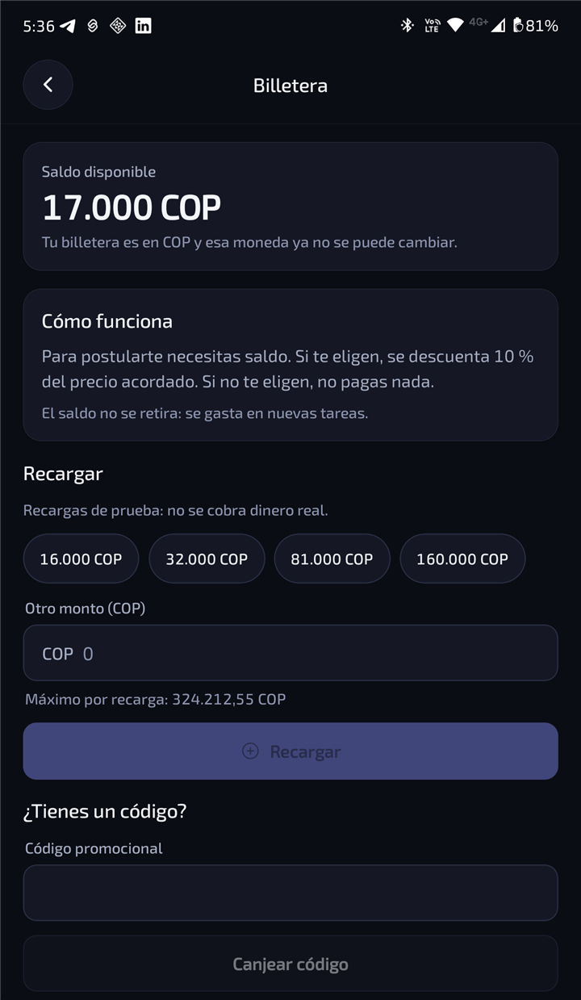

# Billetera y comisión

- **Postularse es gratis.** Solo si te eligen se descuenta de tu billetera una comisión del precio
  acordado.
- **Si el servicio no llega a empezar** (lo cancelan o renuncias antes de iniciar), la comisión se
  devuelve.
- La billetera está en la **moneda de tu cuenta**, que queda fija desde la primera recarga.
- El saldo no se retira: se usa para postularte a más tareas.
- En esta versión de pruebas las recargas son **de prueba, sin dinero real**.

El pago del servicio en sí se acuerda directamente entre las dos personas.

[← Volver](../README.md)
