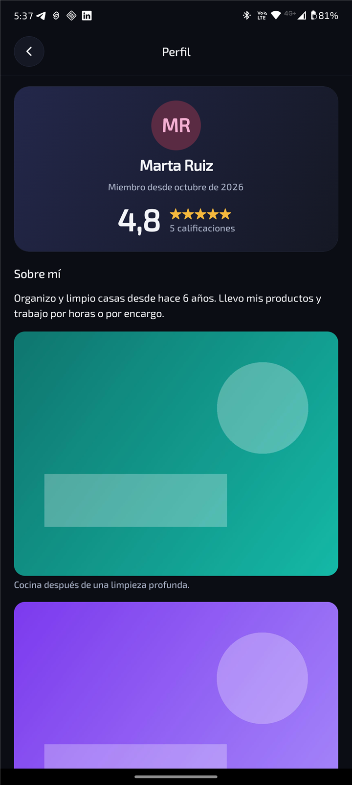

# Tu perfil

Quienes publican tareas ven tu perfil antes de elegirte. Desde la pestaña **Perfil** puedes:

- **Poner tu foto:** toca tu foto (o tus iniciales) y elige una de la galería o tómala con la cámara.
- **"Sobre mí y fotos":** escribe quién eres y muestra tu trabajo con hasta **10 fotos**, cada una
  con su texto. Ordénalas con las flechas.
- **Elegir cómo se ve**, viendo antes un ejemplo de cada opción:
  - **Fotos con texto:** como un documento, cada foto a lo ancho con lo que cuentas de ella.
  - **Galería:** tu presentación arriba y las fotos en cuadrícula; al tocar una se ve grande.

Al subir una foto se reduce de tamaño y se le quitan los datos de ubicación que guarda el teléfono.

En tu perfil también aparecen tu calificación, tus reseñas (puedes responder a cada una) y cómo
trabajas: qué tan rápido sales tras ser elegido y tu puntualidad.

[← Volver](../README.md)
