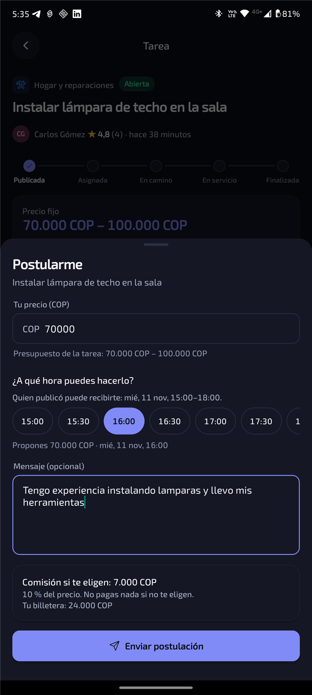

# Postularte a una tarea

1. En **Explorar** verás las tareas abiertas, con la distancia a cada una. Puedes filtrar por
   categoría y distancia.
2. Abre una tarea y toca **Postularme**.
3. Escribe **tu precio**. Verás cuánto sería la comisión si te eligen y si tu billetera la cubre.
4. Elige **a qué hora puedes hacerlo**, dentro del horario en que quien publicó puede recibirte. Si la
   tarea es flexible, propón el día y la hora.
5. Si quieres, añade un mensaje: tu experiencia, herramientas, disponibilidad.

Puedes retirar tu postulación mientras siga pendiente. Si te eligen, la tarea aparece en
**Actividad** y empieza el servicio.

[← Volver](../README.md)
