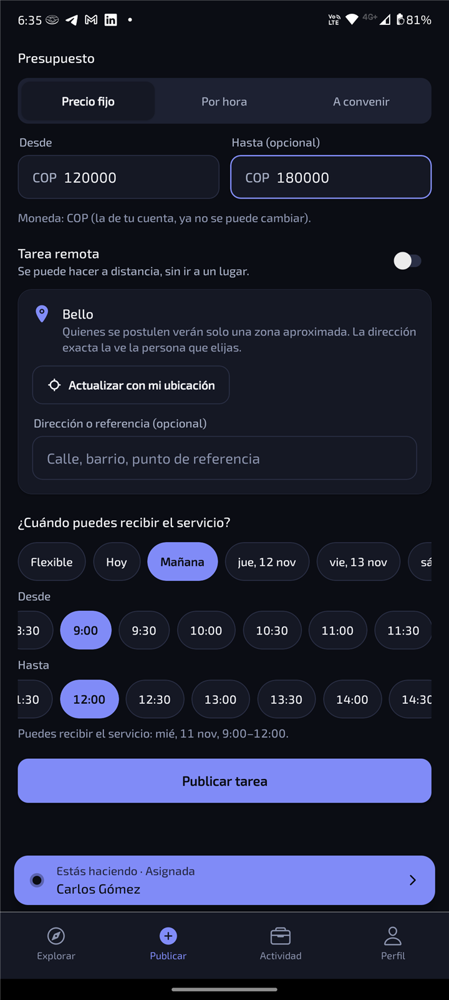

# Publicar una tarea

1. Toca **Publicar** en la barra de abajo.
2. Elige la **categoría** y escribe un título corto y los detalles: qué necesitas, medidas,
   herramientas, lo que haga falta saber.
3. **Presupuesto:** precio fijo, por hora o "a convenir". Puedes poner un rango (desde – hasta).
4. **Dónde:** usa tu ubicación o márcala como remota. Quienes se postulan solo ven una zona
   aproximada; la dirección exacta la ve la persona que elijas.
5. **Cuándo puedes recibir el servicio:** elige el día y un rango de horas (por ejemplo, de 14:00 a
   18:00), o déjalo **flexible** para que cada persona proponga día y hora.
6. Toca **Publicar**.

Mientras nadie esté elegido puedes editarla o cancelarla.

## Elegir a alguien

En la tarea verás cada postulación con su **precio**, su **hora propuesta**, su calificación y su
puntualidad. Toca su nombre para ver su perfil, con sus fotos y reseñas. Cuando decidas, toca
**Elegir**: la hora que propuso pasa a ser la hora acordada y ambos ven sus datos de contacto.

[← Volver](../README.md)
