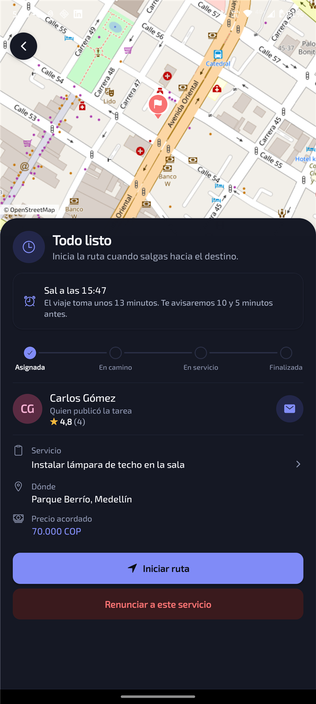

# El servicio en vivo

Cuando eligen a alguien, las dos personas pasan a la pantalla del servicio.

**Si te eligieron:**

- La app calcula cuánto tardas en llegar y te dice **a qué hora salir**. Te avisa con una
  notificación **10 y 5 minutos antes** de esa hora, aunque tengas la app cerrada. Ejemplo: servicio
  a las 16:00 y 1 hora de viaje → sales a las 15:00 → avisos a las 14:50 y 14:55.
- Toca **Iniciar ruta** al salir: quien publicó te verá en el mapa.
- Al llegar, **Iniciar servicio**; al terminar, **Finalizar**.

**Si publicaste:** ves en el mapa por dónde viene, cuánto le falta y, después, cuánto lleva
trabajando.

## Puntualidad

En tu perfil se muestra en cuántos servicios llegaste a tiempo. Es justa: si saliste a la hora que la
app te indicó, un retraso por el tráfico no cuenta en tu contra, y si te eligieron sin tiempo para
llegar, ese servicio no se juzga.

[← Volver](../README.md)
